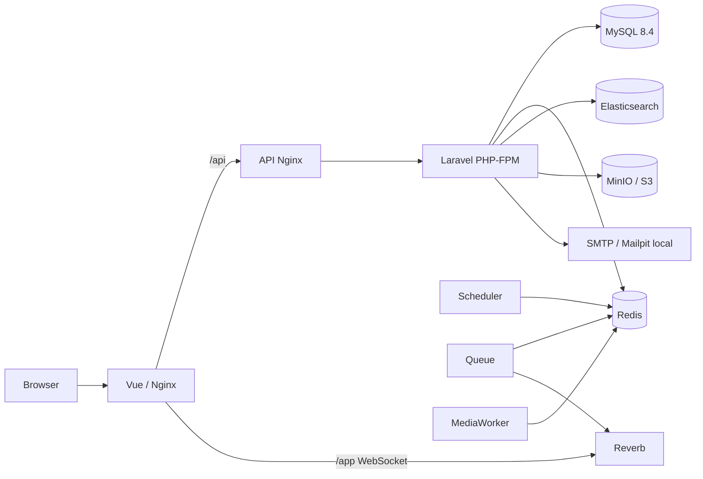

# JBadminton backend

Laravel 13 / PHP 8.4 API for the JBadminton storefront, bookings, orders, social features and Capital Rivals. The Vue app lives in the sibling `BAM_frontend` repository.

## Architecture



`routes/api.php` and `routes/social.php` define HTTP endpoints. Controllers validate requests, services own booking/order/auth logic, and Eloquent models persist to MySQL. Booking creation locks the court row inside a transaction; order creation locks product rows. JWT is the API guard. Redis supports cache, queue and rate limiting. Scout uses Elasticsearch in the production Compose stack. The social overlay adds Reverb, the default/broadcast queue worker, media worker and scheduler. Uploaded files use the configured filesystem disk; local workspace storage and production MinIO/S3 are distinct.

## Local workspace

The isolated stack in `docker-compose.workspace.yml` builds both repositories and uses its own MySQL, Redis, Mailpit, storage volume and network. It does not join the server stack's `jb_net`.

```bash
cd BAM_backend
docker compose -p jbam_workspace -f docker-compose.workspace.yml up -d --build
docker compose -p jbam_workspace -f docker-compose.workspace.yml ps
docker compose -p jbam_workspace -f docker-compose.workspace.yml exec dev-backend php -v
```

Frontend: <http://127.0.0.1:5173> · API: <http://127.0.0.1:8082/api> · Mailpit: <http://127.0.0.1:8026>. PHP commands run inside Docker; the host PHP version is irrelevant. Use `.env.example` as the list of settings; local Compose overrides database and mail hosts to its private services. Never copy local SMTP or test secrets to production.

## Verification before deploy

```bash
cd BAM_backend
bash docker/verify-deploy.sh
```

This command builds the production backend image, builds a PHP 8.4 test image, starts disposable MySQL 8.4 and Mailpit containers, applies all migrations to an empty database, checks migration status, then runs the full PHPUnit suite including SMTP delivery. The disposable database is deleted on exit. A failing command stops the gate.

The backend deploy workflow calls this same gate for every push to `main`/`master` and for manual workflow dispatch, regardless of path filters. It then checks pending migrations against the production database with `migrate --pretend` before restarting services. After restart it applies migrations with `migrate --force` and reports their status. The standalone `docker/deploy-ec2.sh` also runs the gate and production migration check. Do not run `migrate:fresh` on production.

## Production operations

Production backend is deployed from `.github/workflows/deploy.yml` to `/home/ubuntu/BAM_backend` with `docker-compose.yml` plus `docker-compose.social.yml`. The frontend repo deploys its HTTPS Nginx container separately on the shared `jb_net` network. Required production values include `APP_KEY`, `JWT_SECRET`, database credentials, `APP_URL`, SMTP server credentials, Reverb keys and object storage settings. Keep `.env` on the server and out of Git. Configure real SMTP for reset emails.

Useful commands on the server:

```bash
cd /home/ubuntu/BAM_backend
docker compose -f docker-compose.yml -f docker-compose.social.yml ps
docker compose -f docker-compose.yml -f docker-compose.social.yml logs --tail=100 backend queue media-worker scheduler reverb
docker compose -f docker-compose.yml -f docker-compose.social.yml exec backend php artisan migrate:status
docker compose -f docker-compose.yml -f docker-compose.social.yml exec backend php artisan queue:failed
```

Check `/api/` through the frontend domain after deploy. If it fails, inspect `backend` and `api` logs; for delayed social updates inspect `queue`, `media-worker`, `scheduler` and `reverb`. A failed migration stops the workflow and needs investigation before another deploy. Before any schema change on a live system, take a MySQL backup and retain the previous image/commit. Rolling back application code does not roll back a database migration automatically; write a forward repair migration when data has changed.

More Docker setup details are in [DOCKER.md](DOCKER.md).
